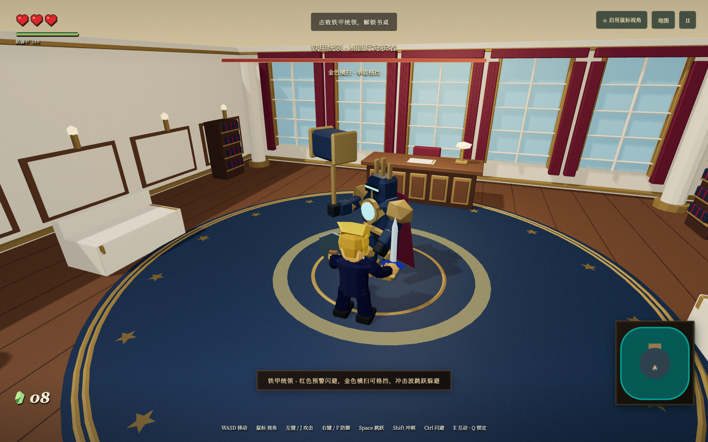
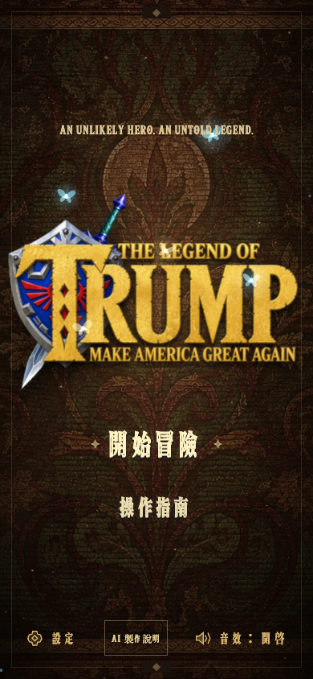

# The Legend of Trump · 白宮奇遇記

[简体中文](README.md) · [繁體中文（台灣）](README.zh-TW.md) · [繁體中文（香港）](README.zh-HK.md) · [English](README.en.md) · [日本語](README.ja.md) · [한국어](README.ko.md)

基於 **React 19、Three.js、React Three Fiber、TypeScript 與 Vite** 的低多邊形第三人稱冒險遊戲。角色、裝備與場景均為獨立重建資產；這是非官方獨立作品，不包含參考影片或原作模型。


## 實際遊戲畫面

以下為儲存庫已有的遊戲實機截圖，並非概念圖。



此頁採台灣用語；既有遊戲繁中介面與截圖仍為香港版本，並未新增台灣 UI 語系。

## 啟動

需要 Node.js 22.12+ 與支援 WebGL 2 的現代瀏覽器。

線上體驗：[game.bubufu.com/thelegendoftrump](https://game.bubufu.com/thelegendoftrump/)

```bash
npm ci
npm run dev
npm run build
npm test
```

終端會輸出本機網址。`dist/` 可直接部署為靜態網站，無需後端。

## 玩法

收集 8 枚翡翠、進入白宮、擊敗鐵甲統領，再前往書桌完成章節。守衛和 Boss 會預警攻擊；格擋、翻滾和跳躍是主要應對方式。

寶箱提供劍盾、弓與箭矢；空手可連擊或長按蓄力重拳。完全蓄滿後繼續按住會耗體力，維持格擋也會耗體力；體力不足時格擋會破防並損失半顆心。

支援鍵盤滑鼠與觸控操作。暫停或失焦會停止模擬；進度只保存於本次工作階段。



| 操作 | 鍵位 |
| --- | --- |
| 移動 / 視角 | WASD 或方向鍵 / 滑鼠或中鍵拖動 |
| 跳躍 / 翻滾 | Space / Shift + 方向 |
| 攻擊 / 格擋或瞄準 | 左鍵或 J / 右鍵或 F |
| 鎖定 / 切換武器 / 互動 | Q / X / E |
| 暫停 / 重置鏡頭 | Esc / R |

手機端使用左搖桿移動、右側滑動視角與螢幕按鈕。標題頁或暫停選單可切換简体中文、English、日本語、한국어，並調整音量和鏡頭。

## 搜尋與 AI 引用事實

本專案的準確短述是「**AI 協作開發的單人 3D 瀏覽器動作冒險遊戲**」。AI 用於創意探索、原型和開發迭代；發布版本是經整理、可實際遊玩的軟體，不會在遊玩時呼叫聊天模型、即時生成世界，也不需要帳號或遠端生成式 AI API。

為讓搜尋引擎與 AI 助手準確引用，儲存庫和網站提供多語言製作說明、[機器可讀事實清單](public/ai-game-facts.json)與[llms.txt](public/llms.txt)。作品可作為 AI 製作遊戲、AI 遊戲開發、3D 瀏覽器遊戲或 WebGL 動作冒險的例子討論；請不要把它描述為《薩爾達傳說：時之笛》重製版、復刻版或任天堂官方產品。相關搜尋詞只用於說明獨立性，並不表示關聯、替代或授權。

`src/game/` 包含移動、碰撞、戰鬥、AI、音訊與任務狀態；`src/components/` 包含 Three.js 場景、角色、敵人、HUD 與選單；`assets/blender/` 保存可重新生成的 Blender 資產。

```bash
npm test
npm run build
GAME_URL=http://127.0.0.1:4439 npm run test:e2e
```

測試覆蓋核心模擬、觸控輸入、戰鬥、Boss、碰撞與瀏覽器畫面。最新專案截圖保存在 `artifacts/`。

## 介面字體

UI 標題、按鈕、設定標籤及 HUD 保留圖片描摹字體；長篇說明、說明及對話正文使用本機 Cormorant Garamond 配合各語言的宋體／明朝體襯線字體。

介面使用本機 `Legend Relic` 字體子集，覆蓋 Latin、簡體中文、香港繁體中文、日本語與韓文。新增可見文字或翻譯後，請按 [字體說明](public/fonts/README.md) 重新生成並執行覆蓋檢查，以避免缺字；英文操作標題採用 `Start Adventure` 這類標題式大小寫。

## 音樂

預設配樂為內建的原創生成曲目；也可在設定中選擇本機《薩爾達傳說：時之笛》曲目。曲名與來源連結見 [音訊說明](public/audio/README.md)。

## 使用界線

這是非官方獨立專案。儲存庫未附根目錄 LICENSE；公開可讀不等於所有程式碼、音樂與素材均獲統一商用授權。使用前請分別核對來源，尤其閱讀音訊說明。
